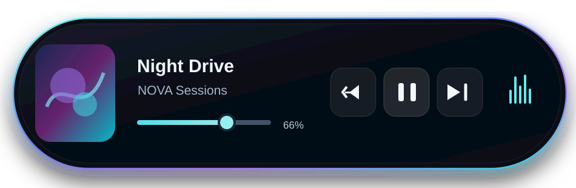
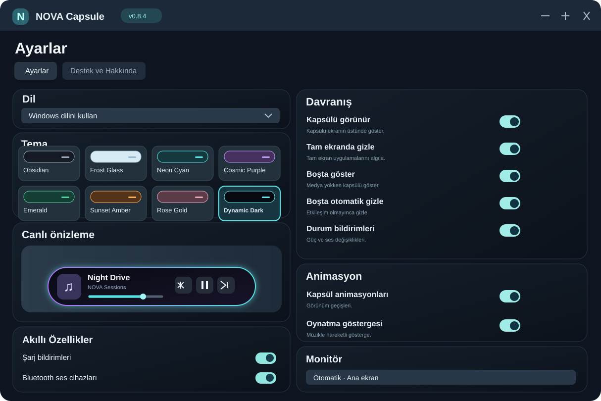

# NOVA Capsule · Hamage Software

**A compact, customizable desktop utility for Windows 11.**  
**Windows 11 için ücretsiz masaüstü yardımcı uygulaması.**

[**Get NOVA Capsule free on Microsoft Store**](https://apps.microsoft.com/detail/9P860V6W5ZJQ) · [Website](https://hmahmut.github.io/hamage-software/) · [Privacy policy / Gizlilik politikası](https://hmahmut.github.io/hamage-software/privacy.html) · [Contact / İletişim](mailto:hacibalboa@gmail.com)

**Latest released version:** NOVA Capsule **0.8.4** · Microsoft Store package **1.8.4.0**  
**Platform:** Windows 11, x64 · **Price:** Free

## What can NOVA Capsule do?

- **Expandable media capsule:** see track details and album art; control playback and volume.
- **8 visual themes:** including the new **Dynamic Dark** style.
- **Built-in timer:** quick presets and countdown controls.
- **Device notifications:** battery, power-adapter and compatible Bluetooth audio status.
- **Desktop controls:** tray show/hide, visibility and animation preferences, monitor selection.
- **10 interface languages**, including Arabic right-to-left layout.
- **Local settings:** preferences are stored on your device.

The **0.8.4 update** adds Dynamic Dark, tray visibility improvements, a Windows system notification sound option and performance optimizations. Some adapter and startup scenarios were not fully tested on physical hardware; please report any issues you encounter.

## Görseller / Visual previews

These are **illustrative interface previews**, not exact screenshots of a running app.

## Download / İndir

**[Install NOVA Capsule free from Microsoft Store](https://apps.microsoft.com/detail/9P860V6W5ZJQ)**

Search **NOVA Capsule** in Microsoft Store if the link does not open.

## Feedback / Geri bildirim

Issues, feature ideas and comments are welcome: **hacibalboa@gmail.com**  
Please include your Windows version, NOVA version and reproduction steps when reporting a bug.

## About this repository

This repository hosts the **Hamage Software website** (GitHub Pages): `index.html`, `privacy.html`, `styles.css`, `main.js` and `assets/`.

It **does not contain the NOVA Capsule application source code**. Please do not mistake this website repository for an open-source release of the app. Visual content and brand identity belong to Hamage Software.

[Hamage Software](https://hmahmut.github.io/hamage-software/) · [Optional developer support](https://buymeacoffee.com/hamagesf)
